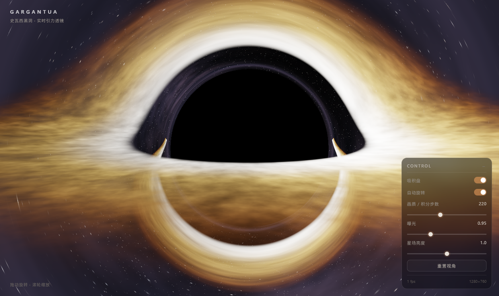
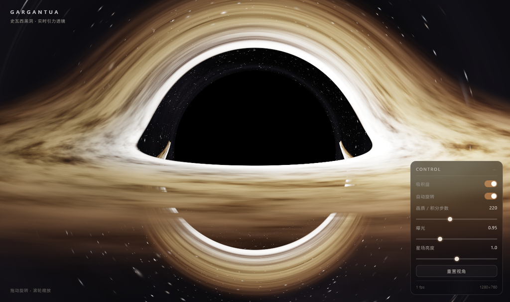
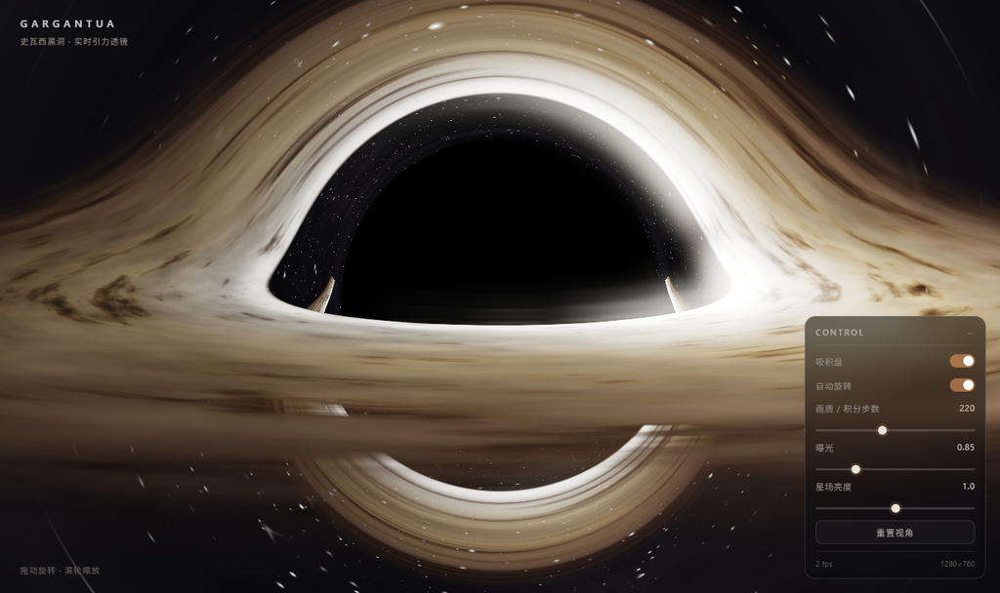
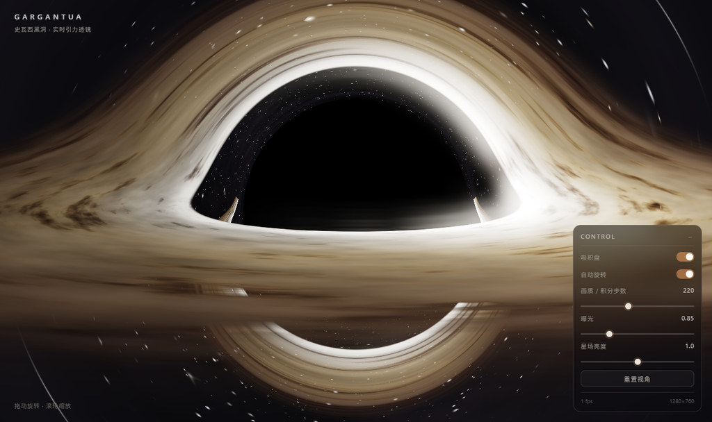
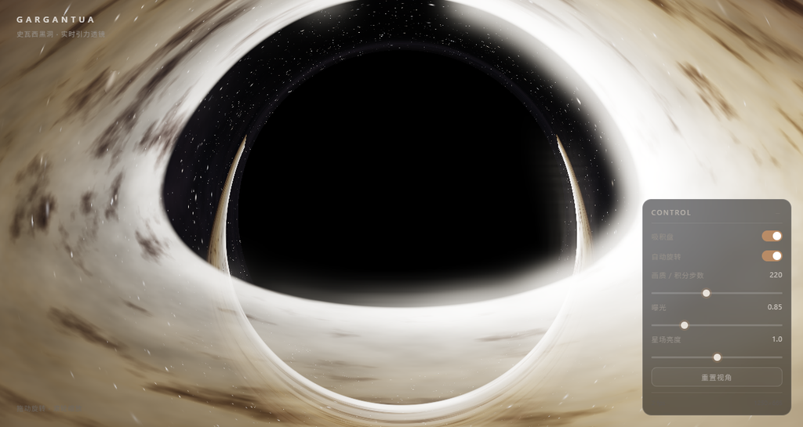
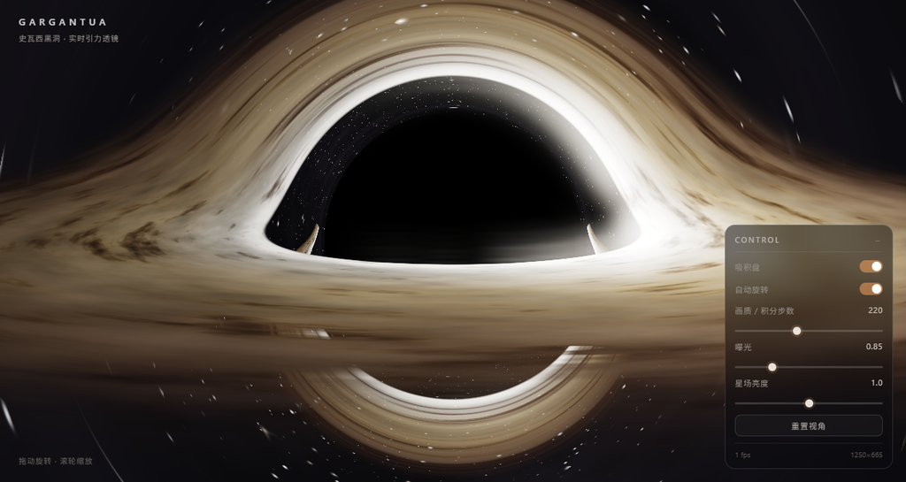
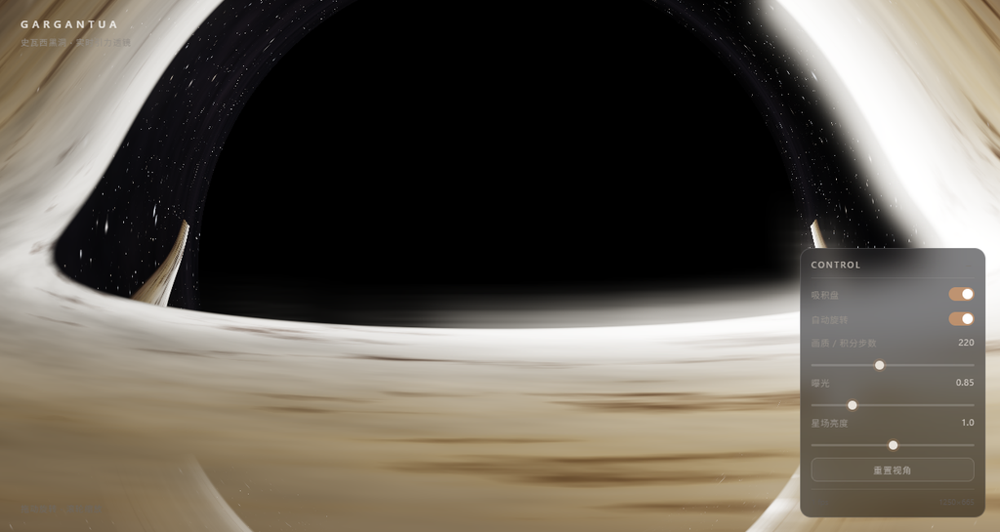
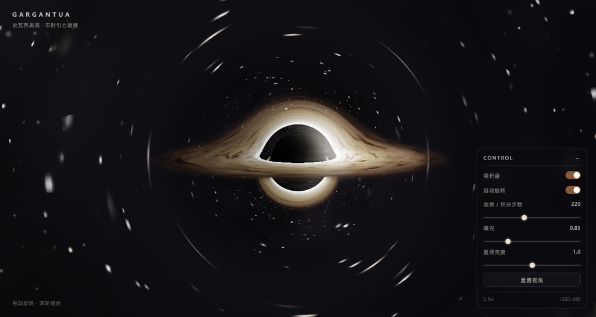
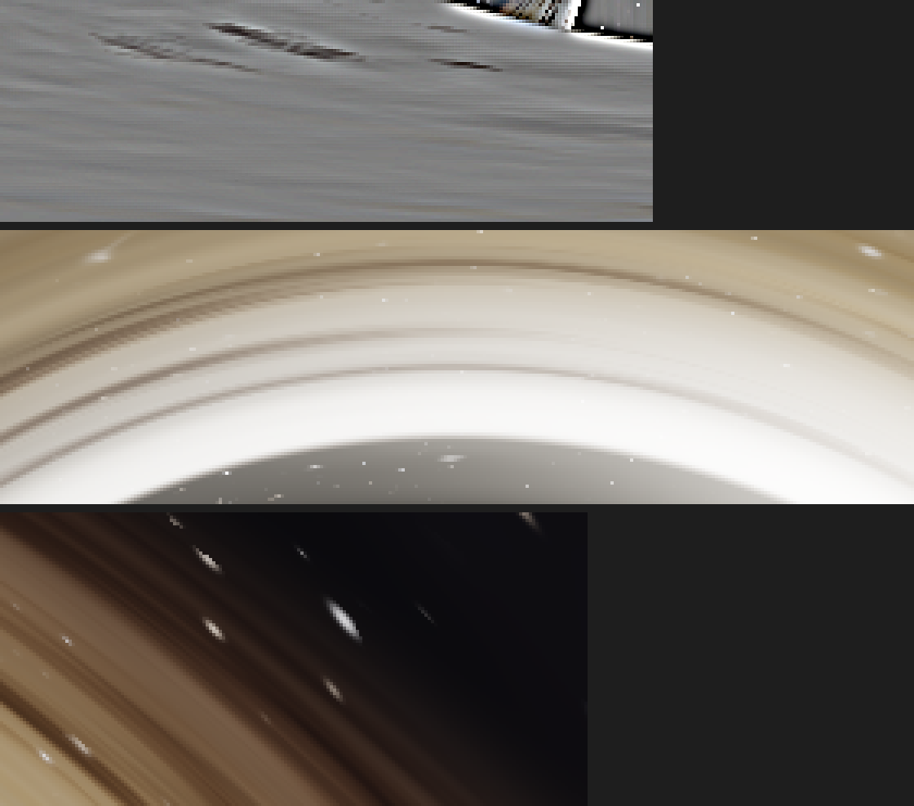

# 卡冈图雅 · 实时黑洞引力透镜

*[English →](README.md)*

仿《星际穿越》黑洞卡冈图雅的 WebGL2 实时渲染页面。**单文件、零依赖、不用构建**：每个像素都在片元着色器里积分零测地线，吸积盘、相对论增亮、引力红移和 HDR 泛光全部在 GPU 上算出来。


## 打开方式

双击 `blackhole.html`（或拖进浏览器窗口）。需要支持 **WebGL2** 的浏览器：较新的 Chrome / Edge / Firefox / Safari。页面自包含，`file://` 直接可用，不需要服务器。

想在线看：给仓库开启 GitHub Pages，访问 `/blackhole.html`（根目录的 `index.html` 只是一个跳转）。

## 交互

| 操作 | 效果 |
|---|---|
| 拖动 | 旋转视角（带惯性平滑） |
| 滚轮 | 缩放相机距离（7 – 80） |
| 右侧面板 | 吸积盘开关、自动旋转开关、积分步数（100–400）、曝光、星场亮度、重置视角 |

## 实现要点

- **光线积分**：逐像素积分零测地线，弱场近似加速度 `a = -1.5·h²·r/r⁵`（`h²` 为轨道角动量平方，沿测地线守恒），rk2 半步长 + 随半径自适应的步长。黑洞阴影、吸积盘被透镜弯曲出的上下两个像、爱因斯坦环，都是积分结果，不是画出来的形状。
- **吸积盘**：无限薄盘平面穿越采样 + 斜穿光程补偿；各向异性 fbm 湍流（径向高频、角向低频 → 差速剪切出的丝状结构）；内缘 ISCO 增亮 + 径向温度色梯度。
- **相对论效应**：多普勒增亮（盘的一侧明显更亮）+ 引力红移 + 亮度 boost；星场同样被透镜扭曲。
- **后期泛光**：场景渲染到 RGBA16F 线性 HDR 缓冲 → 亮度阈值提取（1/4 降采样）→ 四级可分离高斯模糊 → ACES 色调映射合成。
- **自适应分辨率**：帧时间超过 30 ms 时内部分辨率从 1.0 降到 0.45，低于 15 ms 再逐步升回。默认积分步数 220。

## 性能

默认 220 步是给独显调的。机器偏慢时**优先把步数降到 150–180**，画面损失很小，剩下的交给自适应分辨率。

## 目录

| 路径 | 内容 |
|---|---|
| `blackhole.html` | 交付页面，781 行，单文件 |
| `index.html` | 两行跳转，只为让 GitHub Pages 从根路径可用 |
| `preview.png` | 最终效果截图 |
| `screenshots/` | 各轮迭代渲染图（见下） |
| `analysis/` | 纹理分析裁切图（4 倍最近邻放大） |
| `tools/` | 无头浏览器验证脚本 |

## 验证脚本

这一版是对着**仪表读数**开发出来的，而不是靠肉眼看截图：页面内建 `window.__diag`（实测字段 `gl, err, frames, fps, w, h, steps, hdr, post`）和 `window.__state`（相机状态，供自动化读取与驱动）。

依赖 **Node 18+**（用到全局 `fetch` / `WebSocket`）和一个 Chromium 内核浏览器。浏览器会从常见安装位置自动探测；装在别处就用 `BROWSER_BIN` 指定：

```bash
BROWSER_BIN="C:/Program Files/Google/Chrome/Application/chrome.exe" node tools/shot.mjs
```

```bash
node tools/shot.mjs [输出png] [等待ms] [页面url]   # 无头截图 + 诊断读数
node tools/drag.mjs                              # 断言拖动改变 yaw/pitch、滚轮改变距离
node tools/zoom.mjs                              # 4 个相机距离下各渲染一张（含两个极限值）

python tools/analyze.py [输入png] [输出前缀]      # 亮度统计、细节度量、4 倍放大裁切
python tools/map.py [输入png]                    # 亮度 ASCII 图 + 行列剖面
python tools/checkzoom.py [目录]                 # 揪出变全黑的 zoom_*.png
```

`tools/browser.mjs` 是三个 Node 脚本共用的浏览器启动 / CDP 封装。一次成功的 `shot.mjs` 输出（无头 + 软渲染）：

```
DIAG  : {"gl":true,"err":null,"frames":13,"fps":2.01,"w":1280,"h":760,"steps":220,"hdr":true,"post":true}
ERROR : ""
STATUS: 1280×760 | 2 fps
```

那个 2 fps 来自无头 SwiftShader 软件渲染，是光栅化器的锅，不是页面慢。

## 迭代留档

### `s3` → `s11`

每一轮都用"截图 + 诊断读数"双确认。

| `screenshots/s3.png` | `screenshots/s6.png` | `screenshots/s9.png` | `screenshots/s11.png` |
|---|---|---|---|
|  |  |  |  |

### 交互与距离验证

| 拖动后的视角 | dist 25 | dist 12 | 滚轮拉到上限 |
|---|---|---|---|
|  |  |  |  |

`zoom_*.png` 的存在意义是抓一个经典回归：相机拉远之后黑洞从画面里消失。

### 纹理分析



`analysis/` 里是各轮迭代对吸积盘、星场、透镜弧的 4 倍最近邻放大裁切，另有一张盘面高通增强图（`an8_disk_hp.png`），用来判断湍流是不是真的拉出了丝状结构，而不是一片平滑噪声。

## 许可

MIT，见 [LICENSE](LICENSE)。© HinaAyanami
